# sistema-manejo-consultas-medicas

El proyecto se trata de como se hace el manejo de consultas medicas

1. Título del proyecto
> Sistema de Manejo de Consultas Médicas

2. Descripción
El Sistema de Manejo de Consultas Médicas es un programa desarrollado en Java para administrar los pacientes, empleados y citas de un centro oftalmológico. Permite registrar pacientes y empleados, agendar y cancelar citas, y organizar la fila de espera por orden de llegada, dando prioridad a las emergencias. Además, facilita el inicio de consultas, el registro de signos vitales y diagnósticos, y la consulta del historial médico de cada paciente.

3. Instalación
 
    Prerrequisitos:
    Antes de comenzar, debe tener instalado el Java Development Kit (JDK por sus siglas) que puede ser descargado en oracle.com. 
    Para verificar si su dispositivo lo tiene instalado:
 
    1. Acceda a la terminal de su computadora (aplicación de Command Prompt en Windows ó Terminal en Mac).
    2. Ingrese el comando "java -version" (si estará usando Visual Studio, se recomienda instalar el Extension Pack for Java).

    Pasos para clonar y correr el programa:
 
    1. Abra su IDE y ubique el menú de "View" en la parte superior a la izquierda.
    2. Seleccione la opción de "Command Palette" (ó puede usar el atajo de Ctrl+Shift+P / Cmd+Shift+P).
    3. En la barra de búsqueda escriba "Git: Clone" y presione Enter.
    4. Copie el enlace que tiene del repositorio en este campo y presione Enter. 
    5. Una vez el proyecto cargue en el IDE, abra el archivo Main.java.
    6. Localice el ícono triangular arriba en la esquina derecha (ó una flecha apuntando hacia abajo justo a su derecha).
    7. Elija la opción de "Run Java" en el Main.java para correr el Sistema de Manejo de Consultas Médicas.

4. Uso

Para ejecutar el programa, vaya a Main.java y corra el código. En el terminal aparecerá el Menú Principal. Seleccione una de las 12 opciones del menú escribiendo el número. 
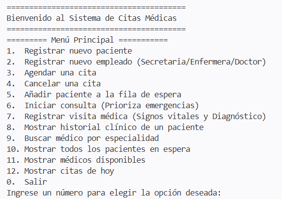 
IMPORTANTE: Luego de hacer su selección o introducir cualquier dato deberá oprimir ENTER para continuar con el programa.

A continuación una descripción de cada opción en el Menú:
    1. Registrar al Paciente: esta opción registrará a un nuevo paciente al sistema y le asignará un identificador único al paciente (PAC-#). Introduzca el nombre y apellido del paciente, su edad e indique si es una emergencia. Conserve le ID del paciente generado para uso futuro.
    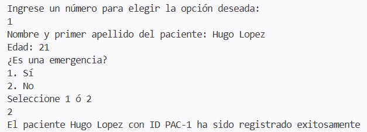 
    2. Reigstrar al Empleado: esta opción llevará registro de los empleados del centro oftalmológico. Deberá introducir los datos del empleado: nombre y apellidos, edad y posición en el centro. Si se registra un Doctor (opción 3) deberá seleccionar su especialidad (1-4): Oftalmólogo General, Oftalmólogo Pediátrico, Neurooftalmólogo o Retinólogo. Luego, presione ENTER y se guardarán los datos del empleado y se creará un identificador único para este empleado.
    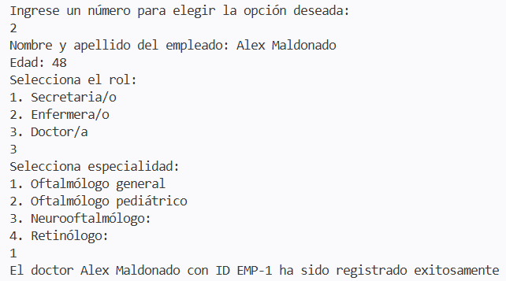  
    3. Agendar una cita: esta opción agendará una cita para un paciente registrado. Deberá introducir el ID del paciente, el ID del doctor, la fecha y la hora de la cita. El sistema generará un ID para la cita (CITA-#).
    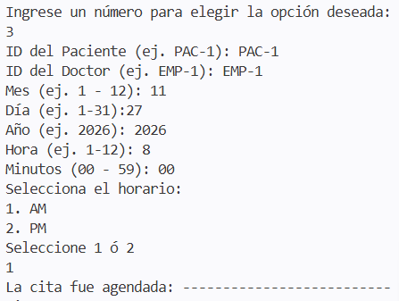  
    Luego de agendar la cita el programa le presentará la informació de la cita que ingresó.
    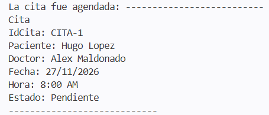  
    4. Cancelar una cita: seleccione esta opción para cancelar una cita existente. Importante: No se podrá cancelar una cita que esté en estado de "En Consulta" ni "Completada", solo se pueden cancelar citas en estado "Pendiente". Deberá introducir el ID de la cita generado en la opción 3.
    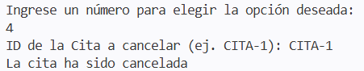  
    5. Añadir paciente a la fila de espera: seleccione esta opción para agregar a un paciente en la lista de espera del centro. Deberá ingresar el ID del paciente que desea añadir. 
    Nota: Si el paciente fue registrado como una Emergencia, al añadir a este paciente en la fila, lo pondrá al principio de la fila indicando que deberá ser el primero en atender sin importar su cita agendada.
    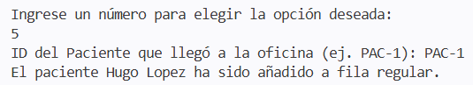  
    6. Iniciar consulta: al seleccionar esta opción, pasará al primer paciente en fila de espera para la consulta con el médico. Deberá colocar el ID de la cita agendada y el programa le indicará que la consulta ha sido iniciada. 
    IMPORTANTE: Si ingresa el ID de una cita que no corresponde al que está al inicio de la fila de espera no permitirá iniciar la consulta.
    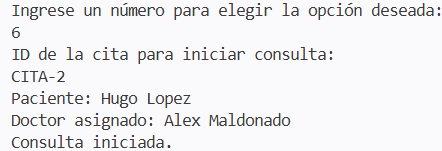 
    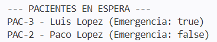 
    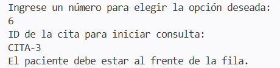  (Output: El paciente debe estar al frente de la fila. El que está al frente de la fila es quien está marcado como una emergencia.)
    IMPORTANTE: Para finalizar la consulta, debe Registrar la visita médica (opción 7)
    7. Registrar visita médica (Signos vitales y Diagnóstico): al seleccionar esta opción, finaliza la consulta del paciente al que se inició consulta (opción 6). Al seleccionar esta opción, deberá introducir el ID de la cita en consulta. Luego, deberá indicar los signos vitales (Presión arterial, Pulso, Agudeza visual y Diagnóstico del médico). Luego, presione ENTER y se registrará la visita médica en el historial del paciente. 
    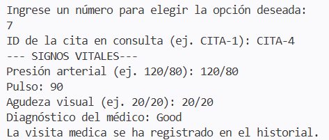 
    8. Mostrar historial clínico del paciente: al seleccionar esta opción podrá ver el historial clínico del paciente. Deberá indicar el ID del paciente del que quiere ver el historial este incluyendo los signos vitales, el diagnóstico y el doctor que atendió al paciente indicado.
    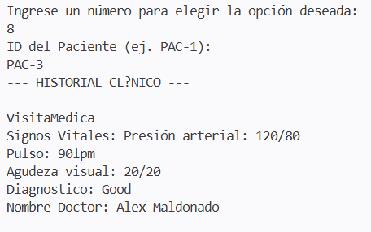 
    9. Buscar médico por especialidad: al seleccionar esta opción podrá buscar entre los doctores registrados con la opción 2 por las especialidades especificadas. El programa le pedirá seleccionar una de las cuatro especialidades (1-4). Una vez seleccionada, el programa le presentará los doctores de esa especialidad, sus IDs de empleados y su disponibilidad.
    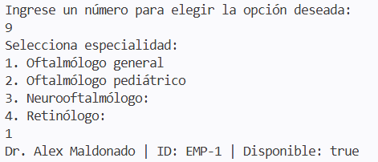 
    10. Mostrar todos los pacientes en espera: al seleccionar esta opción el programa presentará todos los pacientes añadidos a la fila por la opción 5. 
    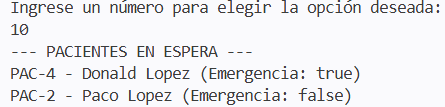 
    11. Mostrar médicos disponibles: al seleccionar esta opción el programa mostrará los doctores disponibles.
    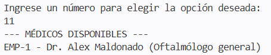 
    12. Mostrar citas de hoy: al seleccionar esta opción, el programa le pedirá que indique la fecha y luego mostrará todas las citas agendadas para ese día incluyendo: el ID de cada cita, el nombre del paciente, el doctor que lo atendió, la fecha, la hora de la cita y el estado de la cita (Pendiente, En Consulta, Completada).
    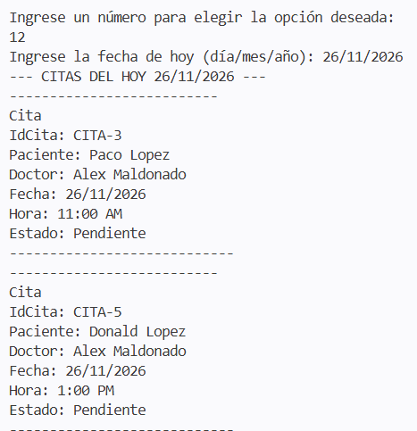 
    13. Eliminar doctor de consulta: al seleccionar esta opción se eliminará a algún doctor registrado con la opción 2. Deberá indicar el ID de empleado del doctor que quiere eliminar.
    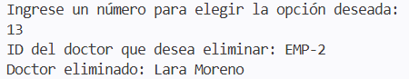
    0. Salir: al seleccionar esta opción, el sistema se va a cerrar.

5. Configuración (si es necesario)
Este proyecto no requiere variables de ambiente, archivos de configuración ni scripts de
configuración. El programa funciona de forma independiente en la memoria utilizando solo Java estándar.

6. Autores o agradecimientos
> Desarrolladores:
    Kristopher Suarez
    Karina Rivera
    Laura Ramos
